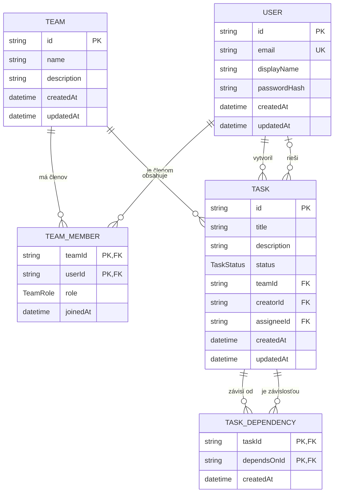

# Kanban frontend

Tento priečinok obsahuje frontendovú časť Kanban nástenky. Načítava tímy a
úlohy z backendu, ukladá zmeny stavov a posiela nové úlohy na API.

## Štruktúra

- `components/BoardColumn.tsx` – vykreslí jeden stĺpec nástenky a jeho úlohy.
- `components/TaskCard.tsx` – vykreslí jednu kartu úlohy a zapojí ju do
  presúvania.
- `data/taskApi.ts` – volania API pre tímy a úlohy.
- `types/task.ts` – typ úlohy, možné stavy a definícia stĺpcov.

Stránka, ktorá tieto časti spája, je v `../../pages/BoardPage.tsx`. Jej štýly sú
v `../../pages/BoardPage.css`.

## Ako sa nástenka zobrazí

1. `main.tsx` spustí React aplikáciu.
2. `BoardPage` načíta tímy z `GET /api/teams` a úlohy vybraného tímu z
    `GET /api/tasks?teamId=...`.
3. Pre každý stav z `COLUMNS` vytvorí `BoardColumn`.
4. Každý stĺpec dostane len úlohy, ktorých `status` zodpovedá stavu daného
   stĺpca. Karty vykreslí `TaskCard`.

## Ako funguje presúvanie

Presúvanie používa knižnicu `@dnd-kit/core`. `BoardPage` nastavuje ovládanie
myšou a dotykom a obaluje stĺpce do `DndContext`.

- `BoardColumn` označí stĺpec ako miesto, na ktoré možno pustiť kartu.
- `TaskCard` označí kartu ako prvok, ktorý možno ťahať.
- Po pustení karty `BoardPage` optimisticky zmení jej stav a pošle
  `PATCH /api/tasks/:id/status`. Pri chybe obnoví pôvodný stav a zobrazí chybu.

## Stav implementácie

Hotové:

- tri stĺpce `TODO`, `IN_PROGRESS` a `DONE`,
- načítanie tímov a úloh cez API,
- presúvanie kariet myšou aj dotykom,
- trvalé uloženie zmeny stavu,
- odoslanie vytvorenia úlohy cez `POST /api/tasks`,
- loading a chybové stavy.

Zatiaľ chýba:

- živé aktualizácie cez WebSocket,
- úprava úloh.

Vytváranie úloh predpokladá, že backend poskytuje `POST /api/tasks` s telom
`title`, `description`, `teamId` a `assigneeId`. Endpoint implementuje backendová
úloha nezávisle od tejto integrácie.

## Užitočné príkazy

V priečinku `frontend/`:

```sh
npm run dev
npm run lint
npm run build
```

## Databázová schéma

Kanban používa PostgreSQL databázu spravovanú cez Prisma. Nástenka pracuje
hlavne s tímami, členstvom v tíme a úlohami. Závislosti medzi úlohami sú
uložené v spojovacej tabuľke `TaskDependency`.



Vzťahy a mazanie záznamov:

- `TeamMember` je spojovacia tabuľka medzi `User` a `Team`; dvojica
  `teamId` + `userId` tvorí zložený primárny kľúč.
- Každá `Task` patrí do jedného tímu a má jedného autora. Tím sa pri zmazaní
  kaskádovo zbaví svojich úloh.
- Riešiteľ úlohy je voliteľný; pri zmazaní používateľa sa `assigneeId`
  nastaví na `NULL`.
- `TaskDependency` modeluje závislosti medzi úlohami. Zložený kľúč zabraňuje
  duplicitnej dvojici závislosti.

Zdrojom schémy je [`backend/prisma/schema.prisma`](../../../backend/prisma/schema.prisma).
